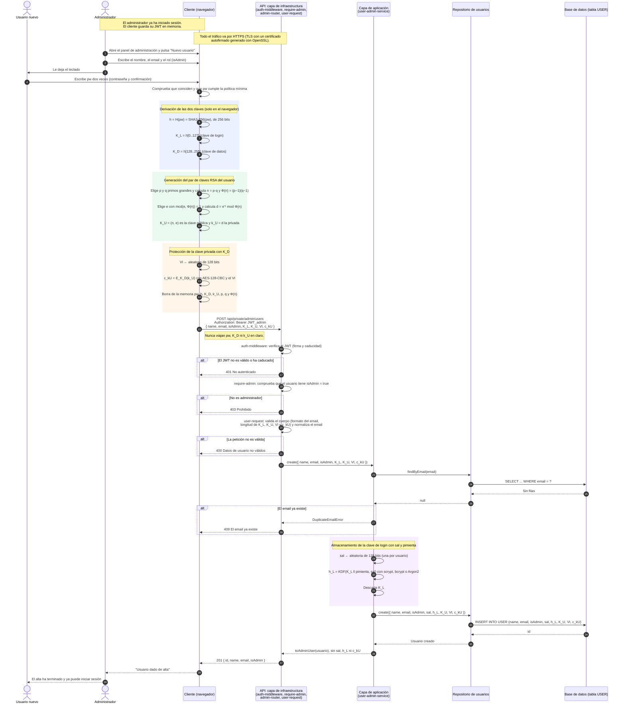

# Diagrama de secuencia: alta de usuario con cifrado

> **Estado:** propuesta de diseño. El proyecto todavía no cifra nada: hoy el
> alta (`POST /api/private/admin/users`) guarda la contraseña en texto claro
> (`server/src/application/user-admin-service.js`). Este documento describe
> cómo debería ser el alta cuando se implemente la capa de seguridad.
>
> **Fuentes:** temas 1 a 4 de la asignatura (fundamentos, introducción a la
> criptografía, cifrado en flujo y en bloque, y criptografía con teoría de
> números) y las anotaciones de clase en `docs/servidor-tener-encuenta.md`.

## Escenario

El alta se hace **en persona**. El administrador ha iniciado sesión en el
panel de administración y le deja el teclado al nuevo usuario para que
escriba su contraseña. Ni el administrador ni el servidor llegan a ver la
contraseña.

La idea central de las anotaciones:

1. La contraseña se resume con un hash de 256 bits: `H(pw)`.
2. Ese resumen se parte en dos mitades de 128 bits:
   - `K_L` es la **clave de login**. Viaja al servidor, que solo guarda un
     hash de ella con sal y pimienta.
   - `K_D` es la **clave de datos**. Nunca sale del navegador y cifra la
     clave privada del usuario.
3. El navegador genera el par de claves RSA del usuario. La clave pública se
   guarda en claro en la base de datos. La clave privada se guarda cifrada
   con `K_D`.

Así el servidor no tiene información suficiente para obtener `K_D` ni la
clave privada (conocimiento cero).

## Notación

Se sigue la notación de los temas 1 a 4.

| Símbolo | Significado |
|---|---|
| `pw` | Contraseña que escribe el usuario. |
| `H(x)` | Función resumen SHA3-256 (salida de 256 bits). |
| `‖` | Concatenación. |
| `K_L` | Clave de login: los 128 bits altos de `H(pw)`. |
| `K_D` | Clave de datos: los 128 bits bajos de `H(pw)`. |
| `p, q` | Primos grandes aleatorios de RSA (secretos). |
| `n = p·q` | Módulo RSA. |
| `Φ(n) = (p−1)(q−1)` | Función de Euler de `n` (secreta). |
| `e` | Exponente público, con `mcd(e, Φ(n)) = 1`. |
| `d` | Exponente privado: `d·e mod Φ(n) = 1`. |
| `K_U = (n, e)` | Clave pública del usuario U: `E_K_U(m) = m^e mod n`. |
| `k_U = d` | Clave privada del usuario U: `D_k_U(c) = c^d mod n`. |
| `E_k(m)` / `D_k(c)` | Cifrado y descifrado simétrico con la clave `k` (AES-128). |
| `VI` | Vector de inicialización aleatorio de 128 bits (modo CBC). |
| `c_kU` | Clave privada cifrada: `E_K_D(k_U)` con AES-128-CBC y `VI`. |
| `sal` | Valor aleatorio distinto para cada usuario, guardado en la tabla. |
| `pimienta` | Valor aleatorio común a todos los usuarios. Se guarda fuera de la base de datos, en la configuración del servidor. |
| `KDF(x, sal)` | Hash lento para guardar contraseñas: scrypt, bcrypt o Argon2. |
| `h_L` | Lo que se guarda para comprobar el login: `KDF(K_L ‖ pimienta, sal)`. |

## Diagrama

## Qué queda guardado y quién lo conoce

| Dato | Dónde está | ¿Lo conoce el servidor? |
|---|---|---|
| `pw` | Solo en la cabeza del usuario. | No |
| `K_D`, `k_U` | En ningún sitio en claro. Se recalculan o se descifran en el navegador al iniciar sesión. | No |
| `K_L` | Viaja por TLS durante el alta y el login. Se descarta tras calcular `h_L`. | Solo de paso, no lo guarda |
| `sal`, `h_L` | Tabla `USER` | Sí, pero solo sirven para comprobar `K_L` |
| `pimienta` | Configuración del servidor, fuera de la base de datos | Sí |
| `K_U` | Tabla `USER`, en claro | Sí (es pública) |
| `VI`, `c_kU` | Tabla `USER` | Sí, pero sin `K_D` no puede descifrar `k_U` |

Al iniciar sesión el navegador recalcula `H(pw)` y obtiene de nuevo `K_L` y
`K_D`. Envía `K_L` para autenticarse, recibe `VI` y `c_kU`, y descifra la
clave privada con `k_U = D_K_D(c_kU)`. Después usa `K_U` y `k_U` para cifrar y
descifrar los datos de sus tarjetas. El detalle está en
[diagrama-secuencia-login.md](diagrama-secuencia-login.md).

## Puntos que hay que decidir

- **Sal en el hash del cliente.** Las anotaciones piden un hash
  determinista: `H(pw)` sin sal. Pero entonces dos usuarios con la misma
  contraseña tienen la misma `K_D`. Además, si se filtra la base de datos,
  `c_kU` se puede atacar por fuerza bruta probando contraseñas con SHA3, que
  es muy rápido. La mejora es usar `H(pw ‖ email)` o, mejor, un KDF lento
  también en el cliente (PBKDF2 o Argon2).
- **Modo de cifrado de `k_U`.** El tema 3 presenta CBC con VI. CBC protege la
  confidencialidad, pero no detecta si alguien ha modificado `c_kU`. Como
  mejora se puede añadir un MAC o usar AES-GCM.
- **Tamaño de RSA.** El navegador debe generar como mínimo un módulo de
  2048 bits (mejor 3072). Se puede usar Web Crypto (`RSA-OAEP`).
- **Valores de 128 bits.** `K_D` de 128 bits es suficiente para AES-128.
  Si se quisiera AES-256 habría que derivar más bits (por ejemplo, con
  SHA3-512).
