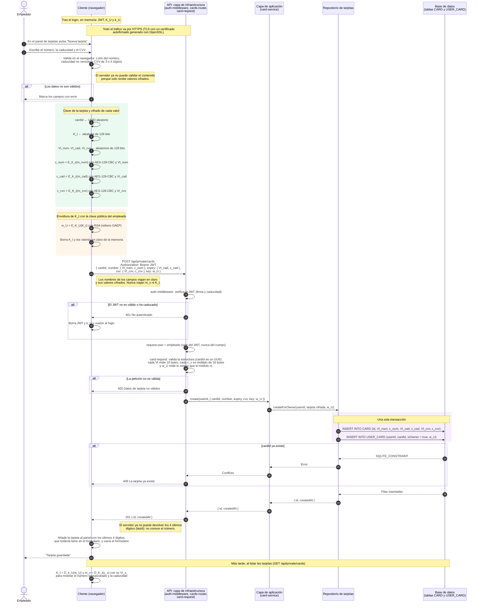

# Diagrama de secuencia: un empleado crea una tarjeta

> **Estado:** propuesta de diseño. Hoy el alta de tarjeta
> (`POST /api/private/cards`) envía el número, la caducidad y el CVV en texto
> claro, y el servidor los guarda tal cual en la tabla `CARD`
> (`server/src/application/card-service.js`). Este documento describe cómo
> debería ser cuando se implemente la capa de seguridad.
>
> **Parte del estado que deja el login.** El navegador ya tiene en memoria el
> JWT, la clave pública `K_U` y la clave privada `k_U` del empleado. Ver
> [diagrama-secuencia-alta-usuario.md](diagrama-secuencia-alta-usuario.md) y
> [diagrama-secuencia-login.md](diagrama-secuencia-login.md).
> Las fuentes son las mismas: los temas 1 a 4 de la asignatura y
> `docs/servidor-tener-encuenta.md`.

## Idea

Se usa un **cifrado híbrido**, como describe el tema 4. La criptografía de
clave pública es lenta para cifrar datos, así que se usa solo para cifrar una
clave simétrica de sesión:

1. El navegador genera una clave AES aleatoria `K_t`, distinta para cada
   tarjeta.
2. Cifra cada valor de la tarjeta con `K_t` (AES-128-CBC, con un `VI`
   aleatorio por valor). Así se cumple la anotación: «el JSON se envía en
   texto claro con los valores de cada clave cifrados».
3. Envuelve `K_t` con la clave pública del empleado: `w_U = E_K_U(K_t)`
   (RSA). Solo `k_U` puede abrirla.
4. El servidor guarda los valores cifrados en `CARD` y `w_U` en `USER_CARD`,
   que es la relación entre el usuario y la tarjeta. El servidor no puede
   leer nada.

Guardar la clave envuelta en `USER_CARD`, y no en `CARD`, prepara la fase 2.
Para compartir una tarjeta con otro usuario V basta con añadir una fila con
`w_V = E_K_V(K_t)`, sin volver a cifrar los datos.

## Notación adicional

Además de la de los documentos del alta y del login:

| Símbolo | Significado |
|---|---|
| `m_num`, `m_cad`, `m_cvv` | Valores en claro: el número, la caducidad (`MM/AAAA`) y el CVV. |
| `K_t` | Clave AES-128 aleatoria de la tarjeta. |
| `VI_num`, `VI_cad`, `VI_cvv` | Vectores de inicialización aleatorios, uno por valor cifrado. |
| `c_num`, `c_cad`, `c_cvv` | Valores cifrados: `c_x = E_K_t(m_x)` con AES-128-CBC y `VI_x`. |
| `w_U` | Clave de la tarjeta envuelta para U: `w_U = E_K_U(K_t) = K_t^e mod n`. |
| `cardId` | UUID de la tarjeta, generado en el navegador. |

## Diagrama

## Qué queda guardado y quién lo conoce

| Dato | Dónde está | ¿Lo conoce el servidor? |
|---|---|---|
| `m_num`, `m_cad`, `m_cvv` | Solo en el navegador, mientras se usan. | No |
| `K_t` | En ningún sitio en claro. Se recupera con `k_U` cuando hace falta. | No |
| `VI_x`, `c_x` | Tabla `CARD` | Sí, pero sin `K_t` no los puede descifrar. |
| `w_U` | Tabla `USER_CARD`, en la fila del propietario. | Sí, pero sin `k_U` no puede obtener `K_t`. |
| `k_U` | Solo en la memoria del navegador durante la sesión. En la base de datos está cifrada como `c_kU`. | No |

## Cambios que implica en el código actual

- **Esquema:** `CARD` deja de tener `number`, `expiryMonth`, `expiryYear` y
  `cvv` en claro y pasa a tener los pares `VI_x`/`c_x`. `USER_CARD` añade la
  columna `w_U` (clave envuelta).
- **Validación:** las reglas de `card-request.js` sobre el contenido (Luhn,
  caducidad y CVV) pasan al navegador. El servidor solo comprueba formatos y
  tamaños.
- **Listado:** `toMaskedCard` ya no puede calcular `last4` en el servidor. El
  navegador recibe los valores cifrados y `w_U`, y enmascara el número él
  mismo.
- **El `cardId` lo genera el navegador** antes de cifrar, para poder ligarlo
  a los datos cifrados si se usa AES-GCM (ver más abajo).

## Puntos que hay que decidir

- **Integridad.** CBC no detecta modificaciones. Un servidor malicioso podría
  intercambiar los valores cifrados de dos tarjetas o alterar bits del VI.
  AES-GCM con `cardId` como dato autenticado adicional (AAD) lo detectaría.
- **Relleno de RSA.** `w_U` debe usar RSA con relleno OAEP, no RSA «de libro»
  (`K_t^e mod n` sin relleno), que es determinista y maleable.
- **Caducidad cifrada o en claro.** Cifrarla oculta más información, pero
  impide que el servidor avise de las tarjetas a punto de caducar. Las
  anotaciones piden cifrar todos los valores, que es lo que muestra el
  diagrama.
- **CVV.** En un sistema real no se debería guardar (lo prohíbe PCI DSS).
  Aquí se guarda cifrado porque lo pide la práctica.
