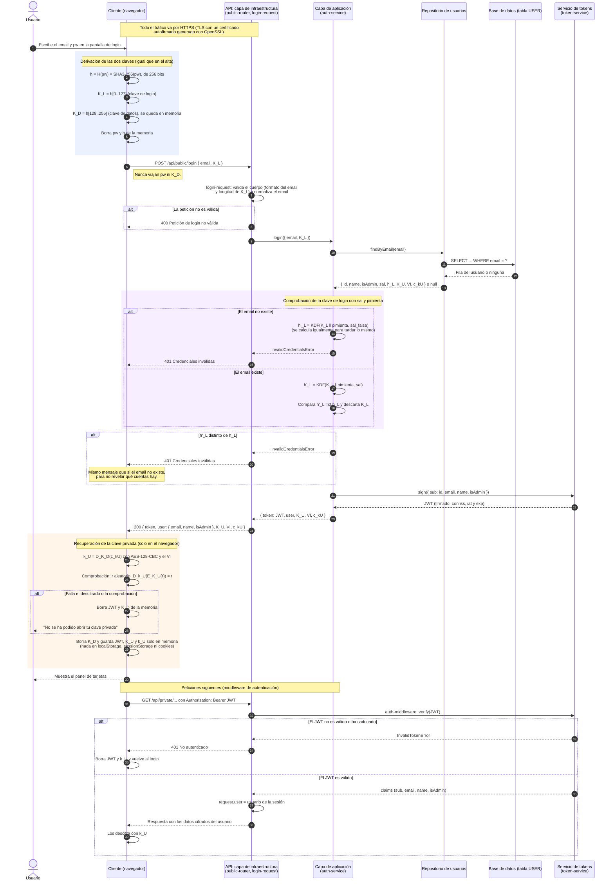

# Diagrama de secuencia: inicio de sesión con cifrado

> **Estado:** propuesta de diseño. Hoy el login (`POST /api/public/login`)
> envía la contraseña y el servidor la compara en texto claro
> (`server/src/application/auth-service.js`). Este documento describe cómo
> debería ser el login cuando se implemente la capa de seguridad.
>
> **Parte de los datos que deja el alta.** El flujo de alta y la notación
> completa están en [diagrama-secuencia-alta-usuario.md](diagrama-secuencia-alta-usuario.md).
> Las fuentes son las mismas: los temas 1 a 4 de la asignatura y
> `docs/servidor-tener-encuenta.md`.

## Qué hay guardado antes del login

Tras el alta, la tabla `USER` tiene una fila por usuario con estos campos:

| Campo | Contenido |
|---|---|
| `email`, `name`, `isAdmin` | Datos de la cuenta. |
| `sal` | Sal aleatoria de 128 bits del usuario. |
| `h_L` | `KDF(K_L ‖ pimienta, sal)`, el hash lento de la clave de login. |
| `K_U` | Clave pública RSA `(n, e)`, en claro. |
| `VI`, `c_kU` | Clave privada cifrada: `c_kU = E_K_D(k_U)` con AES-128-CBC. |

La `pimienta` está en la configuración del servidor, no en la base de datos.

## Idea del login

1. El navegador vuelve a calcular `H(pw)` y obtiene las mismas dos mitades
   que en el alta: `K_L` y `K_D`. Es posible porque el hash es determinista.
2. Solo `K_L` viaja al servidor. El servidor repite el cálculo
   `KDF(K_L ‖ pimienta, sal)` y lo compara con `h_L`.
3. Si coincide, el servidor emite el JWT de sesión y devuelve `VI` y `c_kU`.
4. El navegador descifra la clave privada con `K_D`: `k_U = D_K_D(c_kU)`.
   El servidor nunca puede hacer este paso porque no conoce `K_D`.

## Notación adicional

Además de la del documento del alta:

| Símbolo | Significado |
|---|---|
| `h'_L` | Hash que calcula el servidor durante el login con la `K_L` recibida. |
| `=ct` | Comparación en tiempo constante (`crypto.timingSafeEqual`), para no filtrar información por el tiempo de respuesta. |
| `sal_falsa` | Sal ficticia para un email que no existe, para que el servidor tarde lo mismo. |
| `JWT` | Token de sesión firmado por el servidor (paso 2 del proyecto). |
| `r` | Valor aleatorio de prueba para comprobar que `k_U` corresponde a `K_U`. |

## Diagrama

## Qué sabe cada parte durante el login

| Dato | Navegador | Red (dentro de TLS) | Servidor |
|---|---|---|---|
| `pw` | Un instante, se borra tras el hash. | No viaja. | Nunca lo ve. |
| `K_D` | Hasta descifrar `c_kU`, luego se borra. | No viaja. | Nunca lo ve. |
| `K_L` | Un instante. | Viaja una vez. | Lo usa para calcular `h'_L` y lo descarta. |
| `sal`, `h_L`, `pimienta` | No los recibe. | No viajan. | Los usa para la comprobación. |
| `VI`, `c_kU`, `K_U` | Los recibe. | Viajan cifrados por TLS. | Los guarda, pero no puede abrir `c_kU`. |
| `k_U` | En memoria mientras dura la sesión. | No viaja. | Nunca lo ve. |
| `JWT` | En memoria mientras dura la sesión. | Viaja en cada petición. | Lo firma y lo verifica. |

Al recargar la página se pierden el JWT y `k_U`, igual que hoy se pierde el
token. Hay que volver a iniciar sesión.

## Puntos que hay que decidir

- **Enumeración de usuarios.** Con `sal_falsa` y el mismo error 401 el
  servidor tarda y responde igual exista o no el email. La `sal_falsa` puede
  ser fija o derivarse del email, por ejemplo `HMAC(pimienta, email)`.
- **Repetición de `K_L`.** `K_L` es siempre la misma para una contraseña. Si
  alguien la captura (por ejemplo, rompiendo el TLS), puede iniciar sesión
  sin saber la contraseña. No puede abrir `c_kU`, porque para eso necesita
  `K_D`. La mejora es un reto-respuesta: el servidor manda un valor aleatorio
  y el navegador lo firma con `k_U`.
- **Integridad de `c_kU`.** CBC no detecta modificaciones. Si el servidor
  altera `c_kU`, el descifrado da basura o falla el relleno. La comprobación
  con `r` evita usar una clave equivocada, pero AES-GCM o un MAC lo
  detectarían directamente.
- **Limitación de intentos.** Conviene limitar los intentos por email y por
  IP para frenar la fuerza bruta en línea.
- **Segundo factor.** El diseño de la fase 1 contempla TOTP. Si se añade, iría
  entre la comprobación de `h_L` y la emisión del JWT.
